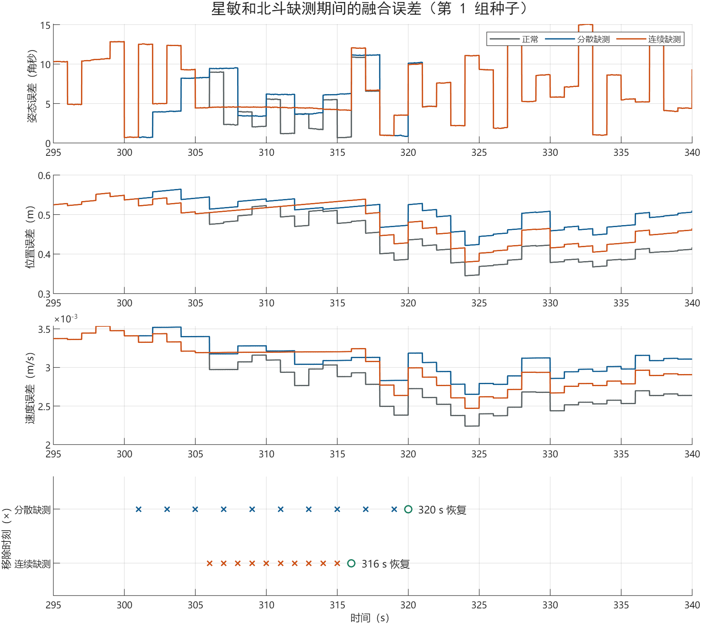
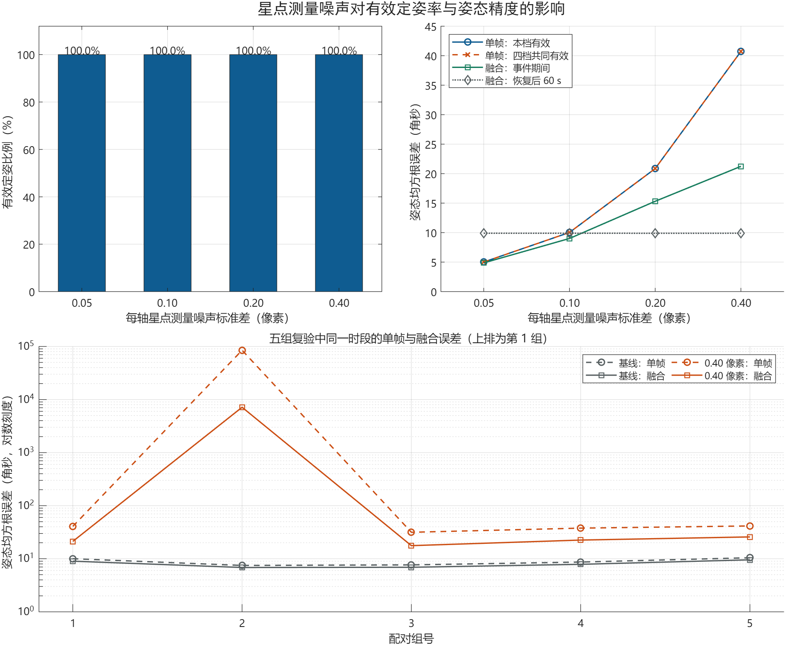
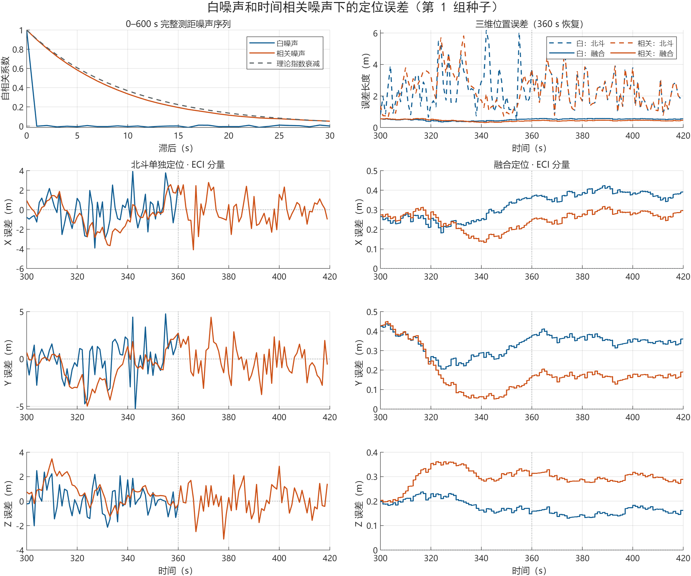
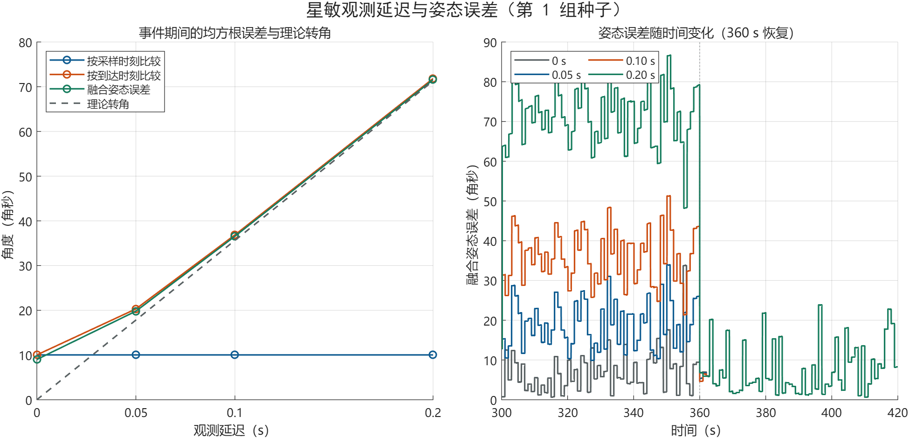

# 卫星组合导航传感工况实验结果

在同一条 500 km 圆轨道上，使用相同的 ESKF 对四类传感工况进行了比较。首轮运行 12 个工况，其中的 8 个工况又分别用 4 组独立种子重复，共完成 44 次滤波。以下首轮数据来自原工程种子组，配对差值均按“改变工况减去同组正常基线”计算。位置误差为三维误差向量的长度，姿态误差为估计姿态与真实姿态之间的最小旋转角。

## 1　移除同样数量的观测，连续缺测的误差峰值是否更大？

前 300 s 正常跟踪。之后分别移除星敏或北斗的 10 次观测。分散缺测依次移除 301、303、…、319 s 的观测，连续缺测移除 306–315 s 的观测。原种子组中，相应通道都由 600 次更新降至 590 次，另一通道仍更新 600 次。

| 第 1 组种子 | 星敏工况的姿态峰值（角秒） | 星敏工况的恢复段姿态 RMS（角秒） | 北斗工况的位置峰值（m） | 北斗工况的恢复段位置 RMS（m） |
|---|---:|---:|---:|---:|
| 正常 | 12.562 | 8.189 | 0.542 | 0.395 |
| 分散缺测 | 11.198 | 8.200 | 0.564 | 0.479 |
| 连续缺测 | 12.562 | 8.189 | 0.542 | 0.436 |

峰值取 301–319 s，恢复段均方根误差（RMS）取 320–340 s，均含端点。5 组中有 3 组的星敏连续缺测姿态峰值高于分散缺测，另外 2 组次序相反。北斗连续缺测的位置峰值在这 5 组中均低于分散缺测。正常观测的随机误差、进入缺测段时的滤波状态以及恢复更新的时刻都会影响这个窗口内的峰值。在当前基线和 10 次缺测的设置下，数据没有呈现“连续缺测一定更差”的排序。

## 2　像素噪声增大后，定姿成功率和精度分别如何变化？

在 300–359 s 的相同星图上，改变星点中心每轴的测量噪声，重新匹配星点、计算单帧姿态，再将姿态和当帧协方差交给滤波器。

| 每轴标准差（像素） | 有效观测 / 计划观测 | 单帧姿态 RMS（角秒） | 融合姿态 RMS（角秒） |
|---:|---:|---:|---:|
| 0.05 | 60 / 60 | 5.01 | 4.87 |
| 0.10 | 60 / 60 | 10.03 | 9.00 |
| 0.20 | 60 / 60 | 20.86 | 15.31 |
| 0.40 | 60 / 60 | 40.72 | 21.24 |

在第一组种子下，四档星图全部得到有效姿态，误差随像素噪声升高。五组复验揭示了另一种结果：在 0.40 像素档，五组分别得到 **60、58、59、60、60** 次有效姿态。第 2 组的 **317 s** 有一帧匹配了 4 颗星，4 颗星的编号全部识别错误。原模型接受了这次匹配，单帧定姿误差达到 **172.384°**，随后融合姿态误差峰值达到 **12.72°**。在 360–420 s 的恢复段，该组融合姿态 RMS 降至 **9.92 角秒**。

其余四组中，0.40 像素相对 0.10 像素的事件段融合姿态 RMS 增量介于 **10.75–16.25 角秒**。第 2 组有两次无效观测，其中一次没有找到满足条件的候选三角形，另一次匹配程序在输出结果时遇到缺少字段的错误，原传感器接口将其记为无效。这里的有效率反映本工程整条星敏解算流程的实际输出。指标表同时给出全部有效帧和各档共同有效时刻的单帧误差。

## 3　测距噪声幅度相同，时间相关性有什么影响？

白噪声和时间相关噪声的理论标准差均为 3 m。相关过程按卫星独立生成，相关时间为 10 s。每个可见历元使用同一份白噪声驱动两组对照，保持卫星几何和伪距率观测一致。仅在 300–359 s 替换伪距噪声，然后重新完成北斗定位与融合。

| 第 1 组种子 | 完整噪声序列的样本标准差（m） | 滞后 1 s 的自相关系数 | 事件段北斗位置 RMS（m） | 事件段融合位置 RMS（m） |
|---|---:|---:|---:|---:|
| 白噪声 | 3.003 | −0.001 | 2.794 | 0.455 |
| 时间相关噪声 | 3.016 | 0.900 | 2.758 | 0.448 |

在第一组的 60 s 事件窗口内，北斗单独定位的 X、Y、Z 误差分量在白噪声下最长连续同号时长为 **7、7、4 s**，在时间相关噪声下为 **27、25、21 s**。五组配对后，融合位置 RMS 的平均增量为 **0.033 m**，范围为 **−0.133 至 +0.191 m**。输入误差的时间相关性清楚可见，而在当前 60 s 窗口内，融合位置 RMS 的变化方向随种子而变。最长同号时长仅统计事件窗口内连续同号的观测，窗口边缘处的区段可能延伸到窗口以外。图中同时给出单独定位和融合定位在同一惯性坐标系下的三个有符号分量，便于观察偏差维持了多久。

## 4　同一帧星敏量测延后使用，姿态误差增加多少？

对 300–359 s 采样的有效帧分别施加固定延迟。量测及其协方差一起推迟，到达时由原滤波器更新。四种延迟均使用同一批星敏帧，各组更新总数相同。

| 延迟（s） | 理论转角（角秒） | 相对于采样时刻真值的单帧 RMS（角秒） | 相对于到达时刻真值的单帧 RMS（角秒） | 融合姿态 RMS（角秒） |
|---:|---:|---:|---:|---:|
| 0 | 0 | 10.03 | 10.03 | 9.00 |
| 0.05 | 17.82 | 10.03 | 20.30 | 19.81 |
| 0.10 | 35.64 | 10.03 | 36.86 | 36.56 |
| 0.20 | 71.28 | 10.03 | 71.82 | 71.56 |

表中为第 1 组种子的事件段结果。每一帧自身的采样误差都相同；与到达时刻比较时，角差随延迟增大。在 0.10 s 延迟的五组配对复验中，融合姿态 RMS 平均增加 **28.22 角秒**，范围为 **26.80–29.22 角秒**。在这里，恒定转速给出了可计算的时间错位角，便于核对延迟量是否按设定进入滤波更新。

## 补充检验　相关测距噪声会触发北斗创新超限吗？

在实验三的两类工况上回放已保存的量测，记录每次北斗更新前的八维归一化创新平方（NIS）。以八自由度卡方分布的 99% 分位数 20.090235 为门限，白噪声和相关噪声工况在事件窗口各有 300 次更新，均为 0 次超限，最大 NIS 分别为 5.337 和 5.320。在本实验的五组种子中，测距误差的时间相关性延长了部分定位分量同向偏离的时长，所有单次创新仍低于该门限。[分组汇总](results/北斗NIS对照汇总.csv) · [逐次创新记录](results/北斗NIS逐次更新.csv)

[完整指标表](results/metrics.csv) · [各组相对基线的差值](results/paired_by_seed.csv) · [配对差值的均值和范围](results/paired_summary.csv) · [数据字段与复现说明](数据与复现说明.md)
